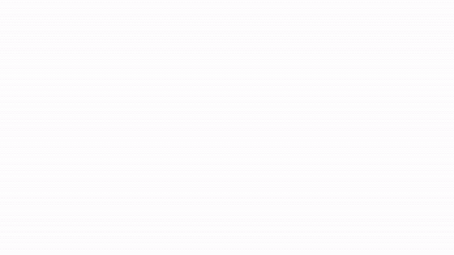

<div align="center">

# 🎬 OpenMotionKit

### Crie vídeos usando o nosso sistema.

**Motion graphics publicitários de verdade, gerados por IA, em código aberto.**
Você pede *"crie um motion para a marca X"* e a IA escreve o roteiro, gera a voz, anima cada cena e entrega o vídeo a **120 fps**.


<br/>

<table>
  <tr>
    <td align="center"><br/><b>OpenMotionKit</b><br/><sub>9:16 · índigo</sub></td>
    <td align="center"><br/><b>Nuvem Café</b><br/><sub>9:16 · terracota</sub></td>
  </tr>
</table>
<br/><b>Tarefa+</b> <sub>· 16:9 · verde-água</sub>

<sub>🇺🇸 <a href="README.md">English</a> · Os três vídeos acima foram feitos 100% com a skill. Nuvem Café e Tarefa+ são marcas fictícias. Vídeos completos em alta: <a href="media/">media/</a>.</sub>

</div>

---

## ✨ O que é

O **OpenMotionKit** é uma *skill* para agentes de IA (Claude Code e outros) que transforma um pedido simples em um **motion graphics completo**, sempre no mesmo estilo, limpo e reconhecível:

| | |
|---|---|
| 🎨 **Visual** | fundo branco + **uma** cor da marca, tipografia **Outfit** centralizada, nada de enfeite solto |
| ✍️ **Texto vivo** | palavras saindo do desfoque e a **palavra-chave grande** com letras pulando e girando |
| 🖊️ **Traço à mão** | sublinhados, riscos, setas e caminhos que se desenham na tela |
| 👆 **Interface** | celular em contorno, chaves liga/desliga, checklist, chat, contadores, gráficos, **mãozinha clicando com onda** |
| 🎥 **Câmera** | câmera **suave** que visita cada item: aproxima, passeia, inclina, com leve "câmera na mão" |
| 🌀 **Transições** | zoom atravessando, chicote lateral, encolher, pop. Nunca corte seco |
| 🔊 **Som** | um efeito para cada ação importante + trilha com *ducking*, tudo **gerado localmente** |
| 🎙️ **Voz** | locução feminina pelo **Gemini TTS**, em **português ou inglês**, alinhada palavra a palavra (faster-whisper) |
| 📦 **Entrega** | **120 fps**, 45–60 s, 9:16 ou 16:9, versão limpa + versão com **marca d'água em mosaico** (transparente, em movimento, difícil de remover), áudio a −14 LUFS |

---

## 🚀 Começando

### 1. Instale a skill

**Com npx (mais fácil)**
```bash
npx openmotionkit
```
Isso instala a skill em `~/.claude/skills/openmotionkit`. Para instalar só no projeto atual:
```bash
npx openmotionkit --project
```

**Claude Code**
```bash
git clone https://github.com/IanDevel0per345/OpenMotionKit.git
mkdir -p ~/.claude/skills/openmotionkit
cp openmotionkit/skills/openmotionkit/SKILL.md ~/.claude/skills/openmotionkit/
```
Depois é só pedir:
> *"Crie um motion para a marca X, nas cores dela, em 9:16."*

**Outras IAs/agentes**: envie o arquivo [`skills/openmotionkit/SKILL.md`](skills/openmotionkit/SKILL.md) e peça para ela ler tudo antes de começar. Ele tem a instalação, as regras, a anatomia de cada animação e o código-fonte completo.

### 2. Ou use o projeto-modelo direto

Requisitos: **Node 18+**, **ffmpeg**, **Python 3** (o Remotion baixa o Chromium sozinho).

```bash
cd openmotionkit/template
npm install
npm run setup          # gera os 21 sons + trilha e os tempos de teste
npx remotion studio    # abre o editor e mostra a demo
```

Renderizar:
```bash
npm run voice                     # voz real (precisa de GEMINI_API_KEY)  — ou: npm run timings
ALIGN_LANG=en npm run voice       # vídeo em inglês (com "profile" em inglês no voice.json)
sh scripts/render.sh minha-marca  # out/minha-marca-limpa.mp4 + out/minha-marca-marca-dagua.mp4
```

> 🔑 A chave do Gemini fica **só** na variável `GEMINI_API_KEY` ou num `.env` (já no `.gitignore`). Sem chave, o vídeo sai como prévia sem voz e as cenas se ajustam sozinhas quando a voz entrar.

---

## 🧩 Como funciona

```
pedido ──► pesquisa (site oficial) ──► roteiro ──► voz Gemini ──► tempo de cada palavra
   └──► cenas (Remotion + lib do estilo) ──► quadros de revisão ──► render 120 fps ──► 2 versões
```

Tudo é sincronizado com a fala: cada animação acontece no instante `w(i)` em que a palavra `i` é dita. O arquivo [`template/src/lib.tsx`](template/src/lib.tsx) **é o estilo**: curvas, durações, desfoques, transições e câmera. As cenas só combinam os componentes:

```tsx
<Scene t={t} a={SC(2)[0]} b={SC(2)[1]} bg={BG} enter="zoomIn" exit="whipL"
  cam={[F(SC(2)[0], 540, 640, 1.26, -1), F(w(18) - 0.2, 540, 860, 1.26, 0, 3), F(SC(2)[1], 540, 1000, 1.04)]}>
  {() => (
    <Center y={380}>
      <Words t={t} size={62} color={MUTE} items={[{ w: "Você", at: w(14), color: INK, weight: 800 }]} />
      <Letters t={t} text="manda:" at={w(15)} size={124} color={AC} weight={800} />
    </Center>
  )}
</Scene>
```

---

## 📁 Estrutura

```
openmotionkit/
├── skills/openmotionkit/SKILL.md   ← a skill (≈5.500 linhas: regras, anatomia, câmera, som, voz PT/EN, código completo)
├── template/                    ← projeto Remotion pronto (lib do estilo, scripts, voz, fonte)
├── examples/                    ← código, roteiro e voz das 3 demos
└── media/                       ← vídeos e GIFs das demos
```

---

## 🎯 Regras de ouro do estilo

- ✅ Branco + **uma** cor. ✅ Ênfase = palavra **maior**. ✅ Toda cena com câmera **suave**.
- ✅ Um som por ação importante. ✅ 120 fps, ≥ 45 s, duas versões.
- ❌ Círculo/mancha de fundo. ❌ Pílula em toda palavra (no máximo 1 por vídeo). ❌ Tique de "engrenagem" em cada palavra. ❌ Fato inventado ou logo redesenhado.

---

## 📜 Licenças e avisos

- Código: **GNU General Public License v3.0** ([LICENSE](LICENSE) e [NOTICE](NOTICE)). Você pode usar, estudar, modificar e compartilhar; se distribuir uma versão modificada, ela também precisa ser GPL v3.0. Os vídeos que você renderizar são seus.
- Fonte **Outfit**: SIL Open Font License 1.1 ([OFL.txt](template/public/fonts/OFL.txt)).
- Sons e trilha: **gerados por código** (`scripts/gerar_sons.py`), sem arquivos de terceiros.
- *Nuvem Café* e *Tarefa+* são **marcas fictícias**. Os estudos com marcas reais dentro da skill são peças de portfólio, sem afiliação; para veicular um vídeo de uma marca real, é preciso autorização dela.

<div align="center"><br/><b>OpenMotionKit</b> · Motion de verdade, aberto pra todo mundo. ⭐ Se curtiu, deixa uma estrela!</div>
